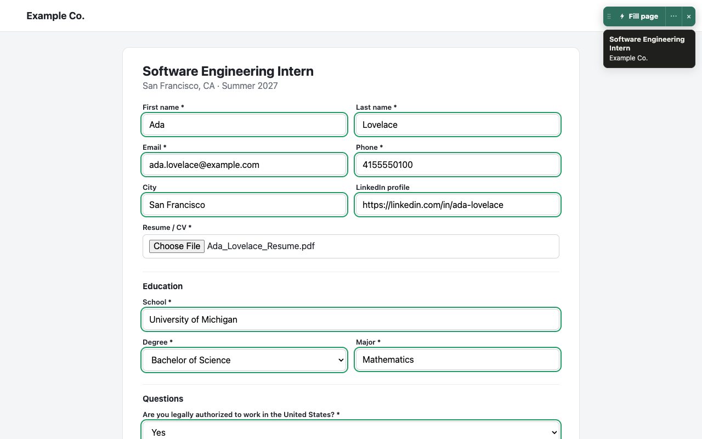
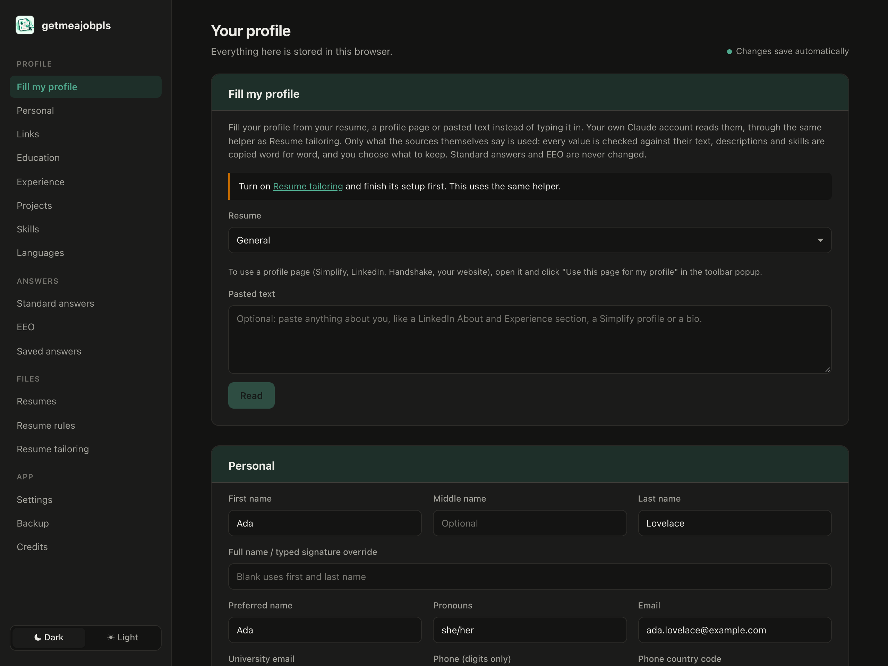

# getmeajobpls

A Chrome extension that autofills job applications, built to fill them faster and more completely than tools like Simplify and Jobright. Open an application on Workday, Greenhouse, Lever or another site, click **Fill page**, and it uploads your resume and answers the form from your profile. It never clicks Submit.

What sets it apart:

- **Fills the parts that usually take longest**: Workday's multi-step forms, searchable dropdowns, forms embedded in a company's careers site, and custom questions you've answered before.
- **Honest about what it filled**: green means filled; anything it isn't sure of is flagged orange instead of guessed.
- **Tailors your resume to each job** with your own Claude account, and can set up your whole profile from your resume.
- **No account, no subscription**: your profile and resumes are stored on your device.





## Features

- **One-click fill** from a panel on the page or the toolbar popup. Uploads your resume first, then fills the rest without overwriting what the site already filled.
- **Picks the right resume and skills** for each job from keywords in the title and description.
- **Review highlights**: green for filled, orange for fields to check, with the reason in the popup.
- **Multi-page forms**: keeps filling each new step of Workday-style flows.
- **Saved answers**: answer a custom question once and similar questions are filled later.
- **Standard and EEO questions**: work authorization, sponsorship, relocation, start dates, referral source and more, all editable. Blank EEO answers become "decline to answer".
- **Every kind of field**, including searchable dropdowns, rich-text editors, date pickers and shadow DOM.
- **Resume tailoring (optional)**: rewrites a resume for the posting with your own Claude account. See [below](#resume-tailoring).
- **Fill my profile (optional)**: Claude reads your resume, a profile page (Simplify, LinkedIn, your website) or pasted text into your profile. Every value is checked against the source, and you review each change before it's saved.

## Supported sites

| Site | Support |
| --- | --- |
| Greenhouse, Lever, Ashby, SmartRecruiters | Dedicated, tested live |
| Workday, iCIMS, SAP SuccessFactors | Dedicated |
| Workable, Rippling, Dover, Teamtailor, Recruitee, Jobvite, Breezy HR | Supported and tested |
| BambooHR, JazzHR, Taleo, Oracle, ADP, UKG, Dayforce, Paylocity, Phenom, Eightfold, Avature and more | Supported, not yet tested live |
| Any other site | Generic, matches fields by their labels |

## Install

Requires Node 20+ and Chrome (or another Chromium browser).

```sh
npm install
npm run build
```

Open `chrome://extensions`, turn on **Developer mode**, click **Load unpacked** and pick `.output/chrome-mv3`. Fill in your profile and upload your resumes on the options page.

After rebuilding, click ↻ on the extension and reload open application pages. To move to another browser, use **Backup → Export JSON** and **Import JSON…**.

## Resume tailoring

Optional. **Tailor resume** rewrites the selected resume for a posting from your resume and profile, using your own Claude account through [Claude Code](https://claude.com/claude-code) (no API key), and keeps it to one page. To set it up, open **Resume tailoring** on the options page and follow the steps there.

> **Always read a tailored resume before you submit it.** It is written by AI, which can get things wrong.

## Privacy

Everything is stored only in your browser. The optional Claude features (resume tailoring and Fill my profile) send what you choose to Claude through your own Claude Code, only when you click their buttons; tailoring may also fetch the posting's description from the job site's public listing. See [PRIVACY.md](PRIVACY.md).

## Credits

Designed and built by [Arnav Podichetty](https://github.com/arnavpodichetty).
